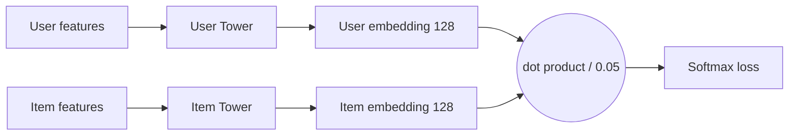

# Two-Tower Recommendation Model

A neural retrieval model for grocery recommendations, built in TensorFlow / Keras. It learns separate embeddings for **users** and **products** in a shared 128-dim space, so recommending is just finding the products closest to a user.

## The Network



Both towers share the same structure:

```
Embeddings (categorical) + continuous features
        ↓
Dense 256, ReLU → Dropout 0.2
        ↓
Dense 128, ReLU → Dropout 0.2
        ↓
Dense 128 (embedding)
        ↓
L2 normalize
```

**User tower** takes 9 features: shopping habits (reorder tendency, basket size, days between orders, organic share, usual day/hour) plus the user's most common aisle (8-dim embedding) and department (4-dim embedding).

**Item tower** takes 10 features: product ID (32-dim embedding), aisle (8-dim), department (4-dim), plus popularity, reorder rate, average cart position, organic flag and typical day/hour of purchase.

L2 normalization puts every embedding on the unit sphere, so the score between a user and item is their cosine similarity.

## How It Learns

- **In-batch negatives:** each batch has 512 (user, purchased product) pairs. Every user is scored against all 512 products, forming a 512 × 512 matrix. The diagonal holds the true pairs and everything else acts as a negative, giving 511 realistic negatives per example.
- **Temperature (0.05):** cosine scores only range from -1 to 1, which gives the softmax weak gradients. Dividing by 0.05 sharpens the scores and stops the model collapsing all items onto one direction.
- **Training:** Adam (lr 0.001), 10 epochs, 80/20 train/validation split.


```

Needs `X_user.npy`, `X_item.npy` and `y_true.npy` in the same folder. Saves the trained model as `two_tower_model.keras`.
